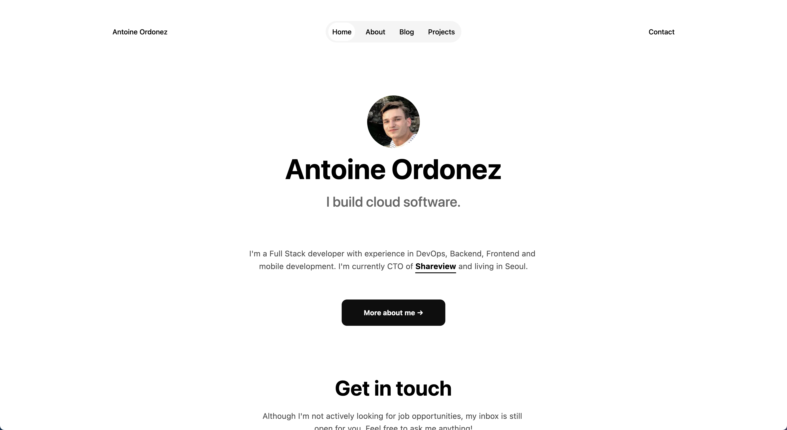
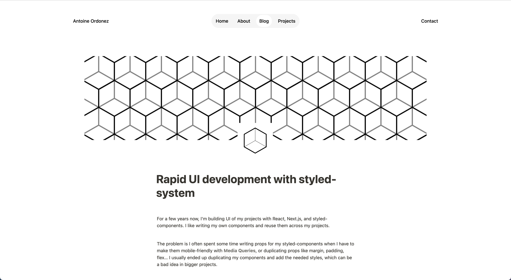

# Dev Matrix ⚡️

> Modern Cloud Software, Full-Stack Engineering & Scalable Digital Solutions.

[](https://devmatrix.io)
[](https://nextjs.org/)
[](https://www.typescriptlang.org/)
[](https://styled-components.com/)
[](LICENSE)

Source code and digital portfolio for **Dev Matrix** — a high-performance web platform featuring engineering projects, interactive blogs powered by Notion, bookmarks, and full-stack cloud architectural work.

Check the live version at [devmatrix.io](https://devmatrix.io) 🚀

---

## 📸 Preview

| Home Page | Blog & Articles |
|:---------:|:---------------:|
| [](https://devmatrix.io) | [](https://devmatrix.io/blog) |

---

## 📑 Table of Contents

- [Overview](#-overview)
- [Key Features](#-key-features)
- [Tech Stack](#-tech-stack)
- [Project Structure](#-project-structure)
- [Getting Started](#-getting-started)
- [Environment Variables](#-environment-variables)
- [Available Scripts](#-available-scripts)
- [Contact Details](#-contact-details)
- [License](#-license)

---

## 🌟 Overview

**Dev Matrix** is an engineering and cloud software development studio. We design, engineer, and deploy high-performance web products, scalable distributed backend architectures, and fluid digital experiences.

This website serves as our digital headquarters, showcasing:
- **Cloud & Full-Stack Capabilities**: Enterprise-grade cloud infrastructure, DevOps pipelines, and modern web application development.
- **Featured Projects**: Real-world platforms and products developed across various technology stacks.
- **Notion-Powered Blog**: Dynamic writing and technical deep-dives synchronized directly from Notion.
- **Reading Bookmarks**: Curated articles, engineering resources, and industry readings.

---

## ✨ Key Features

- **⚡ Blazing Fast Performance**: Powered by Next.js 13 with Server-Side Rendering (SSR) and Static Site Generation (SSG).
- **📝 Headless CMS via Notion API**: Articles authored in Notion and dynamically rendered with syntax-highlighted code blocks using `react-notion-x`.
- **🎨 Design System with Styled-Components & Styled-System**: Custom theme-driven layout primitives (`Container`, `Grid`, `Title`, `Text`, `Button`) for responsive design.
- **📱 Fully Responsive**: Fluid, mobile-first design with interactive mobile navigation.
- **🎭 Smooth Micro-Animations**: Interactive transitions and playful micro-animations powered by `framer-motion`.
- **🔍 Automated SEO & Sitemap**: Dynamic sitemap generation (`next-sitemap`), Open Graph tags, and Twitter Card metadata for search discoverability.
- **🛡 Type-Safe Codebase**: Built entirely in TypeScript for maintainability.

---

## 🛠 Tech Stack

| Technology | Purpose |
| :--- | :--- |
| **[Next.js 13](https://nextjs.org/)** | React Framework with SSG/SSR |
| **[React 18](https://react.dev/)** | Frontend UI Library |
| **[TypeScript](https://www.typescriptlang.org/)** | Type Safety & Developer Experience |
| **[styled-components](https://styled-components.com/)** | CSS-in-JS Component Styling |
| **[styled-system](https://styled-system.com/)** | Responsive Style Props & Theme Primitives |
| **[react-notion-x](https://github.com/NotionX/react-notion-x)** | High-fidelity Notion Page Rendering |
| **[@notionhq/client](https://developers.notion.com/)** | Official Notion API Client |
| **[framer-motion](https://www.framer.com/motion/)** | Fluid Animations and UI Interactions |
| **[next-sitemap](https://github.com/iamvishnusankar/next-sitemap)** | Automated XML Sitemaps & robots.txt |
| **[Plaiceholder / Sharp](https://plaiceholder.co/)** | Image Optimization & Blur Placeholders |

---

## 📂 Project Structure

```text
Dev-matrix/
├── .github/                 # GitHub Actions workflows & repository assets
│   ├── workflows/           # CI build & lint automation
│   └── img/                 # Readme screenshots and previews
├── components/              # Modular UI components & design system
│   ├── Button.tsx           # Interactive button variants
│   ├── Container.tsx        # Styled-system flex/grid layout wrapper
│   ├── Footer.tsx           # Global footer with social & contact links
│   ├── Grid.tsx             # Responsive CSS grid container
│   ├── Layout.tsx           # Master layout with SEO meta & analytics
│   ├── Nav.tsx              # Desktop & mobile responsive navigation
│   └── ...                  # Title, Text, Card, Link, Image primitives
├── icons/                   # Custom SVG icon components
├── notion/                  # Notion API client and bookmark queries
├── pages/                   # Next.js pages and file-based routing
│   ├── _app.tsx             # Root application wrapper & global styles
│   ├── _document.tsx        # Custom document with styled-components SSR
│   ├── index.tsx            # Home page (Hero, Intro, Get in Touch)
│   ├── about.tsx            # About Dev Matrix & technical stack overview
│   ├── about/[slug].tsx     # Detailed work experience case studies
│   ├── projects.tsx         # Showcase of Dev Matrix projects
│   ├── bookmarks.tsx        # Curated technical bookmarks from Notion
│   └── blog/                # Notion-powered blog index & article pages
├── posts/                   # MDX content & Notion blog utilities
│   ├── experiences/         # Work experience markdown entries
│   └── projects/            # Project showcase entries
├── public/                  # Static assets (images, icons, previews)
│   ├── img/                 # Project preview graphics
│   └── favicon.ico          # Browser favicon
├── styles/                  # Global CSS styles and CSS modules
├── next.config.js           # Next.js build configuration
├── next-sitemap.config.js   # Sitemap & SEO configuration
├── tsconfig.json            # TypeScript configuration
└── package.json             # Project dependencies & scripts
```

---

## 🚀 Getting Started

### Prerequisites

Ensure you have the following installed on your machine:
- **Node.js** (v16.x or later recommended)
- **npm** or **yarn**

### 1. Clone the repository

```bash
git clone https://github.com/devmatrix/dev-matrix.git
cd Dev-matrix
```

### 2. Install dependencies

```bash
npm install
# or
yarn install
```

### 3. Configure environment variables (Optional)

Create a `.env.local` file in the root directory for Notion integration and custom domain setup:

```env
SITE_URL=https://devmatrix.io
NOTION_TOKEN=your_notion_integration_token
NOTION_BOOKMARKS_ID=your_notion_database_id
```

> **Note:** If Notion credentials are not configured, the blog and bookmarks fall back gracefully or utilize cached records.

### 4. Run the development server

```bash
npm run dev
# or
yarn dev
```

Open [http://localhost:3000](http://localhost:3000) with your browser to explore the website.

### 5. Build for production

```bash
npm run build
# or
yarn build
```

To start the production server locally:

```bash
npm run start
# or
yarn start
```

---

## 📜 Available Scripts

In the project directory, you can run:

- `npm run dev`: Runs the app in development mode at `localhost:3000`.
- `npm run build`: Compiles and optimizes the production build.
- `npm run postbuild`: Automatically generates `sitemap.xml` and `robots.txt` via `next-sitemap`.
- `npm run start`: Runs the built production application.
- `npm run lint`: Checks for linting errors using ESLint.
- `npm run format`: Formats code files using Prettier.

---

## 📬 Contact Details

For business inquiries, project collaborations, or engineering consultations, connect with **Dev Matrix** through any of our channels:

- ✉️ **Primary Email:** [contact@devmatrix.io](mailto:contact@devmatrix.io)
- 📩 **Alternative Email:** [hello@devmatrix.io](mailto:hello@devmatrix.io)
- 🐙 **GitHub:** [github.com/devmatrix](https://github.com/devmatrix)
- 🐦 **Twitter / X:** [@devmatrix](https://twitter.com/devmatrix)
- 💼 **LinkedIn:** [linkedin.com/company/devmatrix](https://linkedin.com/company/devmatrix)
- 📸 **Instagram:** [instagram.com/devmatrix](https://instagram.com/devmatrix)

---

## 🗝 License

This project is licensed under the **GPLv3 License** - see the [LICENSE](LICENSE) file for complete details.

© 2018–2026 **Dev Matrix**. All rights reserved.
